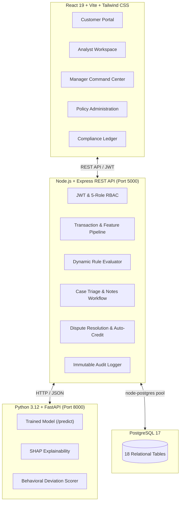

# 🛡️ AI-Powered Fraud Detection & Transaction Risk Management Platform

> An enterprise-grade transaction monitoring platform designed to detect suspicious financial activity using Machine Learning, behavioral analysis, rule-based detection, explainable risk scoring, and automated fraud-management workflows.

---

## 📌 Executive Summary

Financial fraud presents immense operational and compliance challenges for fintechs, neobanks, and payment gateways. Traditional rule-based filters flag known signatures but suffer from high false-positive rates and miss evolving fraud vectors.

This platform implements a **Hybrid Decision-Support Engine**:
- **50% Supervised Machine Learning** (Random Forest / XGBoost with class-imbalance weighting)
- **35% Dynamic Business Rule Engine** (Configurable threshold, velocity, and pattern filters)
- **15% Behavioral Anomaly Signals** (Dynamic deviation from customer baseline)

---

## 🏗️ System Architecture



---

## 🔑 Demo Credentials (Seeded Accounts)

All accounts share the default password: **`Password@123`**

| Role | Email | Scope & Permissions |
|---|---|---|
| **Customer** | `customer@fraudguard.local` | Simulate transactions, view live balance, track & raise disputes |
| **Fraud Analyst** | `analyst@fraudguard.local` | Prioritized case queue, inspect ML & rule signals, record decisions |
| **Fraud Manager** | `manager@fraudguard.local` | Team workload metrics, resolution rates, reassign cases |
| **Admin** | `admin@fraudguard.local` | Configure fraud rules, calibrate thresholds, manage user roles |
| **Auditor** | `auditor@fraudguard.local` | Read-only access to immutable audit log & compliance history |

---

## 🚀 Quick Start Guide (Windows)

### Prerequisites
- **Node.js** (v18+)
- **Python** (3.10+)
- **Git**
- **PostgreSQL** (Portable binaries configured in `C:\Users\atulg\pgsql`)

### 1-Click Launchers (Double Click in Root Directory)
1. **`start-db.bat`** — Starts PostgreSQL database server on port 5432
2. **`start-backend.bat`** — Starts Node.js backend on `http://localhost:5000`
3. **`start-frontend.bat`** — Starts React Vite app on `http://localhost:5173`
4. **`start-ml.bat`** — Starts FastAPI ML service on `http://localhost:8000`

---

## 🧪 Automated Testing & Verification

### 1. Backend Unit Tests (Jest)
```powershell
cd backend
npm test
```
*Tests hybrid risk score calculation (0–100), risk band classification (`LOW`, `MEDIUM`, `HIGH`, `CRITICAL`), and composite formula weighting.*

### 2. ML Service Test Suite (Pytest)
```powershell
cd ml-service
pytest tests/test_predict.py
```
*Tests `/health`, `/predict` validation, schema boundaries, rule fallbacks, and probability calibration.*

### 3. Frontend Production Build (Vite)
```powershell
cd frontend
npx vite build
```

---

## 📊 End-to-End Workflow Verification

1. **Transaction Simulation**:
   - Customer logs in and simulates a ₹105,000 transaction with an unrecognized device and foreign IP.
2. **Detection & Risk Evaluation**:
   - Dynamic velocity is calculated from PostgreSQL (`velocity_last_hour`).
   - Rule `RULE_HIGH_AMOUNT` fires.
   - ML inference model predicts elevated fraud probability.
   - Composite risk score evaluates to `63/100` (`HIGH` risk).
3. **Automated Alert & Case Triage**:
   - Transaction status is marked `flagged`.
   - Alert and Fraud Case (`CASE-YYYYMMDD-XXXX`) are auto-created and assigned to active analyst.
4. **Analyst Investigation & Decision**:
   - Analyst inspects triggered rules, customer history, and feature contributions in the investigation drawer.
   - Records notes and marks case as `confirmed_fraud`.
5. **Auditor Compliance Verification**:
   - Auditor logs in and verifies tamper-evident audit ledger entries.

---

## 📄 License & Attribution
Developed for academic, research, and portfolio demonstrations. Do not connect directly to live production financial rails without banking-grade HSMs and compliance certification.
